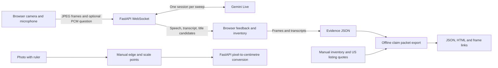

# Architecture

**Live processing.** FastAPI keeps the API key on the server. The browser submits up to three JPEG frames over one Gemini Live session and can send a short voice question after the first frame. Gemini returns audio feedback and transcripts. The browser groups normalized titles and retains frame references. Duplicate physical copies with the same title may be merged.

**Measurement.** The calibration tool uses a ruler visible in a photo. The user marks two reference ticks and two spine edges. FastAPI multiplies the spine's pixel distance by the physical distance per reference pixel. The tool assumes that ruler and spine are approximately coplanar. Measurements in the evaluation are manual trials. The claim packet leaves missing sweep-derived dimensions blank.

**Valuation and evidence.** The included report merges a saved sweep with the user's 27-book inventory and US listing quotes. Nine titles have linked sweep frames, including one manual correction. The remaining books come from the manual inventory. A source URL, missing fields, and edition checks remain visible. Spreadsheet subtotal values are kept distinct from verified claim valuation totals. The standard exporter produces a draft packet for a new sweep. This submission's combined report is a reviewed snapshot.

The public release keeps frame identifiers and transcripts. Original images are withheld and retained in the private submission.
